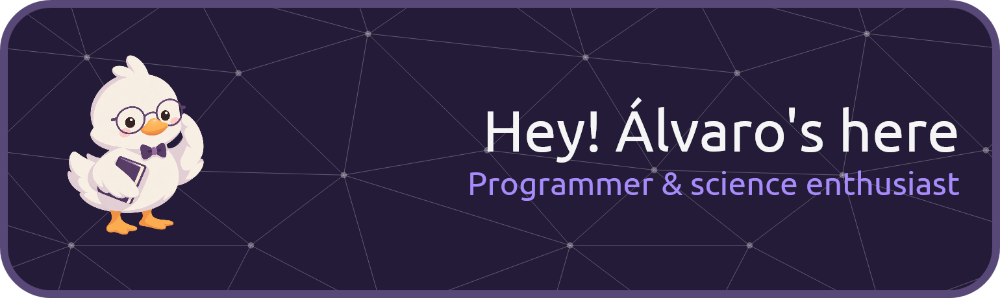

# Get to know Álvaro Fernández
### Computer Science | Mathematics | Physics | Engineering

Hello there! I am Álvaro Fernández, a computer science students and a self-taught enthusiast of mathematics, physics and engineerings.

I began programming when I was only eleven in the videogames field out of the curiosity videogames gave me. I could not even imagine how it was possible that a few lines of code were able to create a new world from stract with which I can interact and quote unquote live.

After a couple of years self-teaching programming, I saw the importance of mathematics in the world, catching my attention and leading me everntually to learn this subject deeply together with physics.

---

# 💻 Computer science skills

### Programming languages

### Other languages

### Database

### Frameworks & Libraries

### Game engines

---

# 🌍 Languages

Although linguistics is not a subject I want to become an expert at, certainly I do enjoy learning languages and develop my life in a multilingual style.

At this point, I can use regularly two languages:

- 🇬🇧 English
- 🇪🇸 Spanish

Currently learning languages:

- 🇩🇪 German

# 📈 GitHub stats

